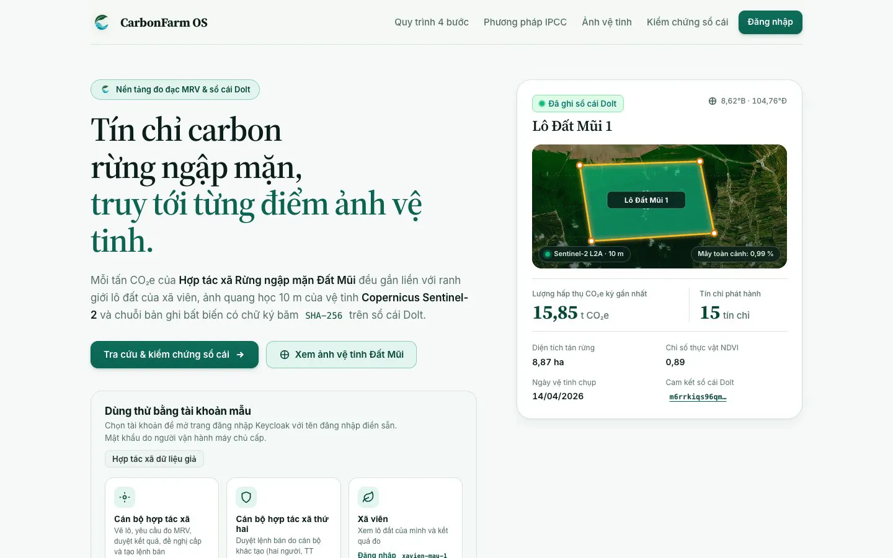
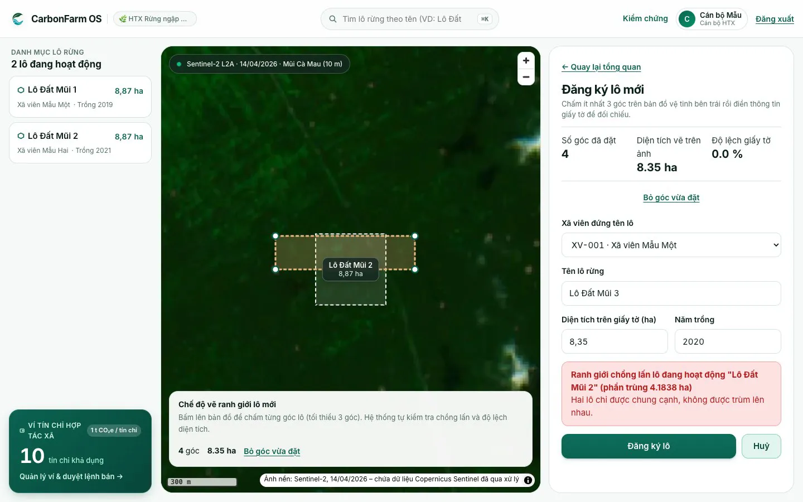
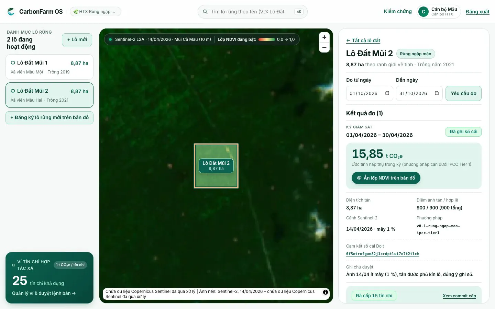
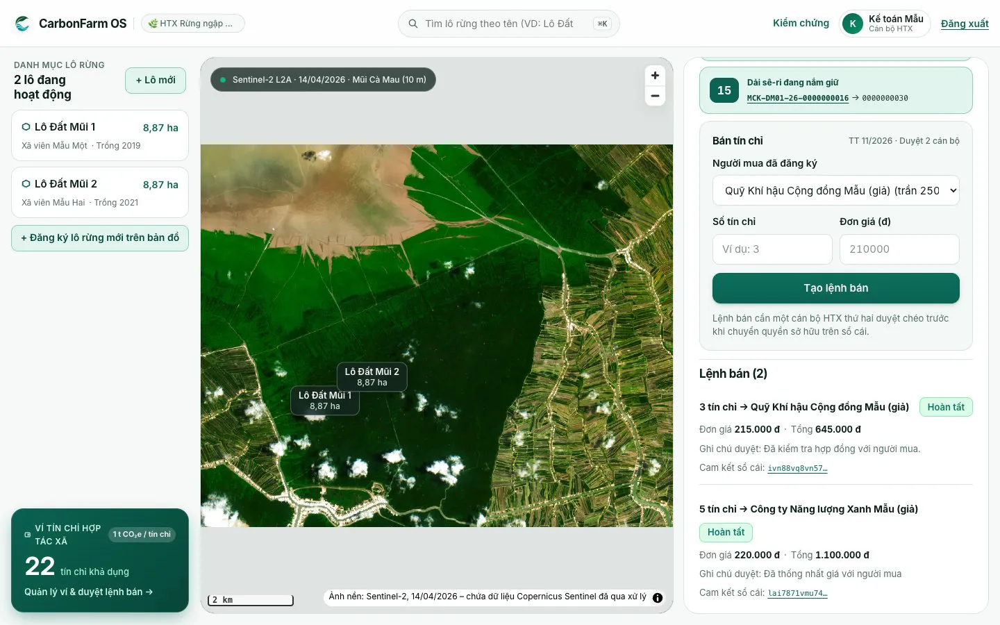
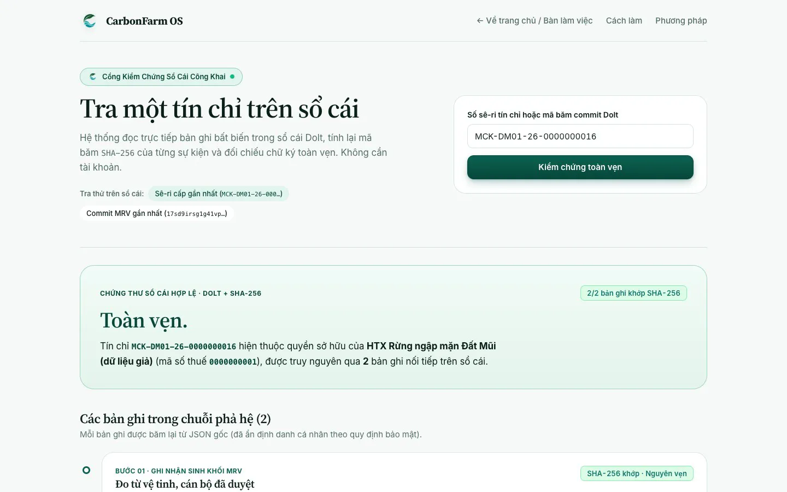
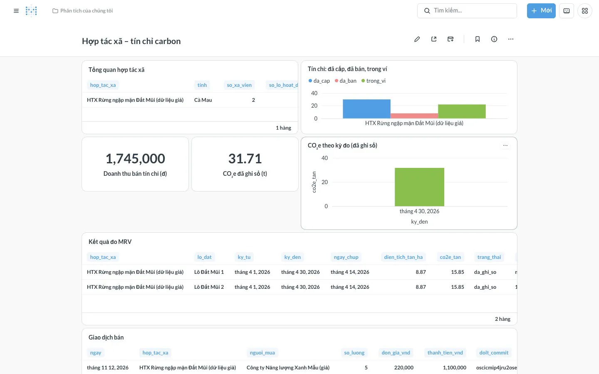

<!-- SPDX-FileCopyrightText: 2026 CarbonFarm OS contributors -->
<!-- SPDX-License-Identifier: GPL-3.0-or-later -->
[Tiếng Việt](README.md) | English

<div align="center">


# CarbonFarm OS

**An open-source carbon-credit platform for smallholders, cooperatives and coastal communities.**<br>
*"People can live with the forest thanks to carbon."*

<p>
  <a href="LICENSE"></a>
  <a href="https://github.com/carbonfarm-os/carbonfarm-os/actions/workflows/ci.yml"></a>
  <a href="https://github.com/carbonfarm-os/carbonfarm-os/releases/latest"></a>
</p>

<p>
  <a href="https://carbonfarm.dzfullstack.com"><b>Demo</b></a> ·
  <a href="https://carbonfarm-os.github.io/carbonfarm-os/"><b>Documentation</b></a> (Vietnamese) ·
  <a href="#mobile-app"><b>Download APK</b></a> ·
  <a href="https://carbonfarm.dzfullstack.com/kiem-chung"><b>Verify a credit</b></a>
</p>

Team **DTU1** · Vietnam Open Source Software Olympiad (OLP PMNM) 2026 · Topic: DX-OS Open-Core

</div>

The user interface, documentation and sample data are in Vietnamese, because the platform is built for Vietnamese cooperatives. This page is an English overview.

## Table of contents
1. [Problem](#problem)
2. [Solution](#solution)
3. [Screenshots](#screenshots)
4. [System architecture](#system-architecture)
5. [Features by user](#features-by-user)
6. [Public credit verification](#public-credit-verification)
7. [Connectors](#connectors)
8. [Project structure](#project-structure)
9. [Technology](#technology)
10. [Installation](#installation)
11. [Demo](#demo)
12. [Documentation](#documentation)
13. [Contributing](#contributing)
14. [License](#license)
15. [Contact](#contact)
16. [Authors](#authors)

## Problem
A **carbon credit** certifies one tonne of CO₂e reduced or removed. Farmers, forest owners and coastal communities who plant and protect forests, especially mangroves, produce those credits. To be issued credits they must go through **MRV**: measurement, reporting and verification.

### What needs solving
1. **Smallholders have no digital MRV.** Measuring biomass by hand is slow, needs hired experts and is hard to repeat. A household holding a few hectares of mangrove can hardly prepare an issuance file on its own.
2. **Existing tools are not built for Vietnam.** The large agricultural carbon platforms (Agreena, Nori, Indigo Ag) are closed source, target the US/EU, have no Vietnamese and do not cover mangroves.
3. **Carbon figures are hard to verify.** Buyers and regulators need to know which satellite scene, which method and which reviewer stand behind a credit, and to whom it was sold. A spreadsheet sent by email cannot answer that.
4. **Errors start at data entry.** Overlapping plots, declared areas that do not match the map, one person creating and approving their own sale: these must be blocked by the system itself, not caught in a later audit.

*Example from the demo (fake data):* a mangrove cooperative in Đất Mũi (Cà Mau) has two plots of about 8.87 ha each. An officer requests a measurement period. The system fetches Sentinel-2 imagery and estimates about 15.85 t CO₂e for plot "Lô Đất Mũi 2" ([calculation, in Vietnamese](methodology/v0.1-rung-ngap-man-ipcc-tier1.md)). The officer approves, the mock Registry issues 15 credits to the wallet, and anyone can look up the serial numbers on the ledger.

### Users
| User | Needs |
|---|---|
| Cooperative officer | Manage members' plots, request and review MRV, issue and sell credits, follow revenue, also on a phone |
| Member (smallholder) | Register and view their own plots; see whether a plot was measured and how many credits it produced |
| Credit buyer (company, fund) | Buy credits with a clear origin (a mock connector in the MVP) |
| Public verifier (regulator, journalist, buyer) | Verify a credit on the ledger without an account, by typing a serial or scanning a QR code |
| Developer | Add a new business domain, or replace a mock connector with a real system, without touching the core |

## Solution
CarbonFarm OS digitises a **cooperative** as a business: members, land plots, MRV records, a credit wallet and revenue. Carbon is estimated from open satellite imagery with a versioned method. An officer reviews every result. Every figure is traceable to its scene, acquisition date, cloud cover, method version and reviewer. Every issuance and sale is written to a versioned ledger. Main flow:

**register a plot → estimate carbon from Sentinel-2 → review MRV → issue credits to the wallet → sell to a (mock) buyer → verify on the ledger**

The MVP covers one ecosystem (mangroves) and one sample area; **cooperative data is fake**. Full proposal (Vietnamese): [`docs/de-xuat.md`](docs/de-xuat.md).

### Two tiers and the H-P-D-I space
- **Tier 1 – `platform/` (headless):** generic core services with no carbon logic: single sign-on, API gateway, secrets, structured and spatial data, unstructured data, workflow, event bus and a versioned ledger. Admin UIs only, no end-user interface.
- **Tier 2 – `domains/carbon/`:** the carbon-credit domain: business database, MRV engine, web app, mobile app and dashboard. Within the H-P-D-I space the team focuses on:
  - **[P] Process:** plot registration → measurement → review → issuance → sale, with error-proofing constraints in the database;
  - **[D] Data:** maps, MRV data lineage, the ledger and dashboards.
  - [I] comes after the MVP.
- **`connectors/`:** Registry, buyer and bank are mock connectors with OpenAPI contracts, replaceable by real systems without changing the core.

### Highlights
| Highlight | Detail |
|---|---|
| Open, reproducible data | Sentinel-2 imagery from a public STAC catalogue, processed with GDAL/rasterio. The method lives in [`methodology/`](methodology/), versioned and cited |
| Every figure traceable | MRV results store the scene, acquisition date, cloud cover, method version and reviewer |
| Versioned ledger | Each MRV result, issuance and sale is a Dolt commit with a hash; record SHA-256 hashes are recomputed on lookup |
| Error-proofing in the database | Rejects overlapping plots (UC005), declared areas more than 10 % off the map (UC004), rejections without a reason (UC015) and self-approved sales (UC031) |
| Four-eyes approval | One officer creates a sale order and another officer of the same cooperative approves it (per Circular 11/2026/TT-BNNMT) |
| Public verification | The `/kiem-chung` page and the mobile app look up serial numbers without an account |
| Web and mobile | SvelteKit web app with MapLibre maps; Flutter app (Android + iOS) for officers and verifiers |
| Pluggable domains | New domains need no Tier 1 changes; an aquaculture sample domain is included ([`docs/viet-mien.md`](docs/viet-mien.md)) |
| Fully open source | GPL-3.0-or-later; every third-party component is OSI-licensed or runs as a separate service from its original image |

## Screenshots
<table>
  <tr>
    <td width="50%"><br>1. Public home page: the flow and sample account cards</td>
    <td width="50%"><br>2. Plot registration (officer): the database rejects an overlapping boundary (UC005)</td>
  </tr>
  <tr>
    <td><br>3. MRV review (officer): written to the ledger, 15 credits issued, wallet at 25</td>
    <td><br>4. Selling 3 credits: a second officer approves, wallet at 22</td>
  </tr>
  <tr>
    <td><br>5. Public verification (no account): the Dolt ledger reports "Toàn vẹn." (intact)</td>
    <td><br>6. Cooperative dashboard (Metabase OSS): credits, revenue, measurements</td>
  </tr>
</table>

Screenshots use fake data; the background contains modified Copernicus Sentinel data (2026). Demo script (Vietnamese): [`docs/demo/kich-ban-15-phut.md`](docs/demo/kich-ban-15-phut.md).

**Mobile app (Flutter):** two tabs. "Hợp tác xã" (Cooperative, login required) shows the credit wallet and plots; "Kiểm chứng" (Verify, no login) lets you type a serial or scan a QR code. Screen details (Vietnamese): [`domains/carbon/di-dong/README.md`](domains/carbon/di-dong/README.md).

## System architecture


| Layer | Components |
|---|---|
| Users | Web (SvelteKit), mobile app (Flutter), public verification page, Metabase dashboard |
| Gateway | APISIX: validates Keycloak JWTs via JWKS; only `/kiem-chung/api` is public and rate-limited |
| Tier 1 | Keycloak, OpenBao, PostgreSQL + PostGIS + PostGraphile, Versity S3 + STAC + TiTiler, Prefect, Valkey, Dolt |
| Tier 2 | `carbon` schema (tables, RLS, UC0xx constraints), Python MRV engine, ledger verification service |
| Connectors | Mock Registry, Buyer and Bank (FastAPI, OpenAPI) |

**Main processing flow:**
1. An officer draws a plot on the map. The web app calls GraphQL `/graphql`; PostgreSQL checks geometry, area, overlap and permissions (RLS) before writing.
2. The officer requests a measurement period. Prefect runs the MRV flow: find Sentinel-2 scenes via STAC, compute NDVI, estimate CO₂e per [`methodology/`](methodology/), store COGs on S3, then wait for review.
3. An approved result is written to the Dolt ledger. When the officer requests issuance, the MRV engine calls the Registry connector for a serial range, writes the ledger, then fills the cooperative wallet.
4. A sale order is approved by a second officer. The Buyer connector accepts it, the Registry transfers ownership and the Bank connector credits the payment. The transaction is written to the ledger and deducted from the wallet.
5. Anyone can look up a serial or commit at `/kiem-chung`: the ledger is read, SHA-256 is recomputed and the record chain is shown.

Details (Vietnamese): [`docs/architecture.md`](docs/architecture.md). Architecture decisions: [`docs/adr/`](docs/adr/).

## Features by user
**Cooperative officer** (sample accounts `canbo-htx-mau`, `canbo-htx-mau-2`)
- Draw plot boundaries over Sentinel-2 imagery. The database rejects:
  - invalid shapes (UC001, UC002);
  - areas outside 0.05–500 ha (UC003);
  - declared areas more than 10 % off the drawing (UC004);
  - overlaps with an active plot (UC005).
- Request a measurement period. The MRV engine finds Sentinel-2 scenes, computes NDVI and CO₂e and shows an NDVI layer on the map.
- Approve or reject MRV results; a rejection needs a reason. Approved results go to the Dolt ledger with a commit hash.
- Request issuance into the cooperative wallet through the (mock) Registry connector, receiving a serial range per Circular 11/2026/TT-BNNMT.
- Create a sale order for a buyer; a second officer approves it.
- View the cooperative dashboard: credits issued, sold and held, revenue, measurements.
- In the mobile app: sign in with Keycloak, view the credit wallet (issued, sold, held), the plot list, plot details and measurement periods.

**Member** (`xavien-mau-1`, `xavien-mau-2`)
- Sees and edits only their own plots (row-level security in PostgreSQL). Registering a plot for someone else is rejected (UC006).

**Public verifier** (no account)
- Look up a serial number or commit hash on the web at `/kiem-chung` or in the app (typed or scanned). See [Public credit verification](#public-credit-verification).

**Administrator**
- Admin UIs of Keycloak, OpenBao, Prefect and Metabase, only reachable on the host running the system.

**Developer**
- Add a new business domain without changing Tier 1: [`docs/viet-mien.md`](docs/viet-mien.md), sample domain [`examples/mien-mau-thuy-san/`](examples/mien-mau-thuy-san/).
- Replace a mock connector with a real system using the same OpenAPI contract (see [Connectors](#connectors)).

## Public credit verification
The page https://carbonfarm.dzfullstack.com/kiem-chung and the "Kiểm chứng" tab of the mobile app call the same read-only API `/kiem-chung/api`. It needs no login and is limited to 60 requests per minute per IP address.
- **By serial number** (for example `MCK-DM01-26-0000000001`): shows the current owner according to the ledger and the chain of records: satellite measurement approved by an officer → Registry issuance → sale and ownership transfer.
- **By Dolt commit hash:** shows the records in that commit.
- For each record the SHA-256 of the original JSON is recomputed and compared with the hash stored in the ledger. The verdict is "Toàn vẹn." (intact) or "Có bản ghi không khớp." (a record does not match). Personal identifiers in records are hidden.
- An unissued or fake serial returns "Không có bản ghi." (no record).
- A QR code may hold a serial number or a link `.../kiem-chung?q=<serial>`; the app reads both.

Why Dolt for the ledger: [ADR 0003](docs/adr/0003-so-cai-co-phien-ban-bang-dolt.md).

## Connectors
The MVP has no real partners yet, so three external systems are mocked in [`connectors/`](connectors/). Each connector has its own OpenAPI contract and fake data, and handles no real money.

| Connector | Mocks | Used at |
|---|---|---|
| Registry (`connectors/registry/`) | The national credit registry, domestic codes and serial ranges per Circular 11/2026/TT-BNNMT | Issuance, ownership transfer on sale |
| Buyer (`connectors/buyer/`) | Credit buyers: buyer list, maximum unit price, order acceptance | Selling credits |
| Bank (`connectors/bank/`) | A bank crediting the sale proceeds | After a sale |

To connect a real system, write a new connector with the same contract; neither Tier 1 nor the domain database changes. Details: [`connectors/README.md`](connectors/README.md), [ADR 0006](docs/adr/0006-connector-mock-va-hop-dong-openapi.md).

## Project structure
```text
carbonfarm-os/
├── platform/              # Tier 1, no business logic: apisix, keycloak, openbao, postgres, postgraphile, prefect, dolt
├── domains/carbon/        # Tier 2 – carbon domain
│   ├── db/                #   migrations, error-proofing constraints, fake data
│   ├── mrv/               #   Python MRV engine (Sentinel-2 → NDVI → CO₂e), ledger verification service
│   ├── web/               #   SvelteKit + MapLibre web app
│   ├── di-dong/           #   Flutter mobile app (Android + iOS)
│   ├── dashboard/         #   Metabase dashboard setup script
│   ├── keycloak/          #   sample users and the mobile app client
│   └── gateway/           #   APISIX routes of the domain
├── connectors/            # Mock Registry, Buyer, Bank, one openapi.yaml each
├── methodology/           # Versioned carbon estimation method with citations
├── compose.yaml           # Docker Compose entry point, includes compose/*.yaml
├── compose/               # platform.yaml, carbon.yaml, connectors.yaml
├── tests/                 # e2e/*.hurl (end-to-end), tich-hop/ (Python integration)
├── examples/              # aquaculture sample domain (plug-in example)
├── docs/                  # architecture, proposal, ADRs, trial guide, deployment, demo script
├── docs-site/             # Starlight documentation site
├── scripts/spdx.py        # checks and adds SPDX headers
└── Taskfile.yml           # go-task commands
```

## Technology
Every service runs from its original image with a pinned version. Versions, sources and the date each license was read: [`DEPENDENCIES.md`](DEPENDENCIES.md); third-party attributions: [`NOTICE`](NOTICE).

| Layer | Component | Role | License |
|---|---|---|---|
| Tier 1 · Identity | Keycloak 26.8.1 | Single sign-on (OIDC, PKCE), realm `dxos` | Apache-2.0 |
| Tier 1 · Gateway | Apache APISIX 3.19.0 | API gateway, JWT validation via JWKS | Apache-2.0 |
| Tier 1 · Secrets | OpenBao 2.7.2 | Generates and keeps service passwords | MPL-2.0 |
| Tier 1 · Data | PostgreSQL 17 + PostGIS + pgSTAC | Structured and spatial data, STAC catalogue | PostgreSQL License / GPL-2.0-or-later / MIT |
| Tier 1 · API | PostGraphile 5.1.5 | GraphQL generated from PostgreSQL, permissions via RLS | MIT |
| Tier 1 · Storage | Versity S3 Gateway 1.10.0, stac-fastapi-pgstac 7.2.0, TiTiler 2.4.0 | COG imagery, STAC catalogue, map tiles | Apache-2.0 / MIT / MIT |
| Tier 1 · Workflow | Prefect 3.9.0 | MRV flow with a review step | Apache-2.0 |
| Tier 1 · Events | Valkey 9.1.3 | Event bus (Streams) | BSD-3-Clause |
| Tier 1 · Ledger | Dolt 2.6.1 | Versioned ledger, every write is a hashed commit | Apache-2.0 |
| Tier 2 · MRV | Python: rasterio + GDAL, numpy, psycopg, PyMySQL, boto3 | Carbon estimation, ledger writes | Project code GPL-3.0-or-later; libraries BSD-3-Clause, LGPL-3.0, MIT, Apache-2.0 |
| Tier 2 · Web | SvelteKit 3 + Svelte 5 + MapLibre GL JS 6 | End-user interface, maps | MIT / BSD-3-Clause |
| Tier 2 · Mobile | Flutter 3.50 (Dart), flutter_appauth, flutter_zxing | Android + iOS app, OIDC sign-in, QR scanning | BSD-3-Clause / BSD-3-Clause / MIT |
| Tier 2 · Dashboard | Metabase OSS 0.64.3 | Cooperative dashboard (separate service, original image, unmodified) | AGPL-3.0 |
| Connectors | FastAPI + uvicorn + pydantic | Mock Registry, Buyer, Bank | MIT / BSD-3-Clause / MIT |
| Data | Sentinel-2 L2A (STAC Earth Search) | Open satellite imagery | Copernicus Sentinel open data |

**Development tools:** go-task, pixi, Hurl, pre-commit, ruff, yamllint, release-please, Syft (CycloneDX SBOM), Starlight (documentation site).

**Deliberately not used:** immudb (Business Source License), MinIO (repository archived), Google Earth Engine (proprietary service; the team chose STAC + GDAL for reproducibility), `metabase-enterprise`, `mobile_scanner` (its Android build pulls in a closed SDK).

## Installation
### Requirements
| Component | Requirement | Notes |
|---|---|---|
| Docker Engine + Docker Compose | Compose v2 with `include:` support (2.20+) | Runs all services |
| go-task | 3.x | Runs the commands in [`Taskfile.yml`](Taskfile.yml) |
| RAM | About 3.9 GB measured with the whole stack running (v0.5.0, `docker stats`) | Metabase about 1.8 GB, Keycloak about 0.8 GB; turn off Metabase if short on RAM |
| Disk | Images total about 10.4 GB (arm64 dev machine) | Plus space for data volumes |
| Internet | Required | MRV downloads Sentinel-2 imagery from Earth Search |
| Python + GDAL (dev machines only) | `pixi install` or the Dev Container | Not needed just to run the stack |
| Mobile app (optional) | Flutter 3.50; Xcode 27 for iOS; Android SDK + JDK 21 for Android | See the [app README](domains/carbon/di-dong/README.md) |

**Operating systems actually used:** macOS on Apple Silicon (dev machines) and Ubuntu (demo server). Windows has not been tried.

### Run on one machine
```bash
cp .env.example .env      # dev configuration
task up                   # start all services (Docker Compose)
task smoke                # end-to-end checks with Hurl
```

After start-up:

| Address | Content |
|---|---|
| http://localhost:9080/ | Web: home page, officer sign-in, plot map, MRV, wallet and sale orders |
| http://localhost:9080/kiem-chung | Look up a credit on the ledger, no account needed |
| http://127.0.0.1:3001/ | Cooperative dashboard (Metabase OSS) |

- **Sample user passwords** (`canbo-htx-mau`, `canbo-htx-mau-2`, `xavien-mau-1`…) are generated by OpenBao at start-up. Read one with `docker compose exec keycloak cat /run/bimat/mk-<name>`, for example `mk-canbo-htx-mau`.
- **OpenBao unseal key:** on first run OpenBao writes it to `.data/openbao/` (outside git). **Keep that file safe; without it OpenBao data cannot be unsealed.**
- **Guided trial:** [`docs/thu-nghiem.md`](docs/thu-nghiem.md).
- **Other commands:**
  - `task check`: SPDX + compose, run before every PR;
  - `task test`: tests that need no running stack;
  - `task lint`;
  - `task license`: add SPDX headers;
  - `task tai-lieu`: build the documentation site.

### Mobile app
- **Download the APK:** the CI job `di-dong` builds an APK on every PR and uploads it to the run's Artifacts (`carbonfarm-apk`). From the next release after v0.7.0, the APK (`carbonfarm-X.Y.Z.apk`) is attached to the [GitHub Release](https://github.com/carbonfarm-os/carbonfarm-os/releases), with its hash in `SHA256SUMS`. The APK is currently signed with a debug key: fine for testing, not yet for Google Play.
- **Build it yourself:**

  ```bash
  cd domains/carbon/di-dong
  flutter pub get
  flutter run --dart-define=API_URL=http://localhost:9080   # local stack; omit --dart-define to use the demo
  flutter build apk --release                               # or: flutter build ios --release --no-codesign
  ```

### Stop and remove data
```bash
task down                 # stop services, keep data volumes
docker compose down -v    # stop and delete all volumes (entered data is lost)
```

Deploying on a server with HTTPS (Vietnamese): [`docs/trien-khai.md`](docs/trien-khai.md).

## Demo
- **Web:** https://carbonfarm.dzfullstack.com, fake data.
- **Public verification:** https://carbonfarm.dzfullstack.com/kiem-chung, no account needed.
- **Trial accounts and suggested tasks:** [`docs/thu-nghiem.md`](docs/thu-nghiem.md) (Vietnamese).
- **Feedback after a trial:** the "Phản hồi dùng thử" (trial feedback) issue form on [GitHub Issues](https://github.com/carbonfarm-os/carbonfarm-os/issues/new/choose).
- **Mobile app** connects to this demo by default.

## Documentation
Documentation site (searchable, Vietnamese): https://carbonfarm-os.github.io/carbonfarm-os/

| Document | Content |
|---|---|
| [`CHANGELOG.md`](CHANGELOG.md) | Changes per version (generated by release-please) |
| [`CONTRIBUTING.md`](CONTRIBUTING.md) | Contribution workflow, dev environment |
| [`CODE_OF_CONDUCT.md`](CODE_OF_CONDUCT.md) | Code of conduct |
| [`docs/de-xuat.md`](docs/de-xuat.md) | Proposal: problem, MVP scope |
| [`docs/architecture.md`](docs/architecture.md) | Two-tier architecture, diagrams |
| [`docs/adr/`](docs/adr/) | Architecture decision records (ADR 0001–0009) |
| [`methodology/`](methodology/) | Versioned carbon estimation method |
| [`connectors/README.md`](connectors/README.md) | Mock connectors and OpenAPI contracts (API) |
| [`platform/README.md`](platform/README.md) | Tier 1: platform services |
| [`domains/carbon/README.md`](domains/carbon/README.md) | Tier 2: carbon domain |
| [`domains/carbon/di-dong/README.md`](domains/carbon/di-dong/README.md) | Mobile app: run, test, build |
| [`docs/thu-nghiem.md`](docs/thu-nghiem.md) | Six-task trial guide |
| [`docs/trien-khai.md`](docs/trien-khai.md) | Public demo deployment |
| [`docs/viet-mien.md`](docs/viet-mien.md) | Writing a new business domain (plug-in) |
| [`docs/demo/kich-ban-15-phut.md`](docs/demo/kich-ban-15-phut.md) | 15-minute demo script |
| [`docs/roadmap.md`](docs/roadmap.md) | Roadmap |

## Contributing
1. **Open an issue** with one of the forms ("Báo lỗi" bug report, "Phản hồi dùng thử" trial feedback, "Việc cần làm" task).
2. **Create a short-lived branch** from `main`, named `<type>/<issue-number>-<name>`.
3. **Commit** with Conventional Commits, described in Vietnamese, ending with `(#issue-number)`.
4. **Open a PR** to `main`. CI must be green and a code owner other than the author must approve (see [`CODEOWNERS`](.github/CODEOWNERS)); PRs are squash-merged.
5. **Releases:** release-please generates the CHANGELOG, the `vX.Y.Z` tag and a GitHub Release with `.tar.gz`, `SHA256SUMS` and an SBOM.

Details: [`CONTRIBUTING.md`](CONTRIBUTING.md).
- Starter tasks: the [`good first issue`](https://github.com/carbonfarm-os/carbonfarm-os/labels/good%20first%20issue) label.
- Questions: [Discussions](https://github.com/carbonfarm-os/carbonfarm-os/discussions).

## License
The source code is released under the **GNU General Public License v3.0 or later** (GPL-3.0-or-later); full text in [`LICENSE`](LICENSE).

> This program is free software: you can redistribute it and/or modify it under the terms of the GNU General Public License as published by the Free Software Foundation, either version 3 of the License, or (at your option) any later version.

- **Why GPL:** copyleft makes every distributed modification of the MRV platform publish its source code. Carbon figures therefore stay verifiable, and improvements return to the community.
- **SPDX in every file:** each source file carries two lines, `SPDX-FileCopyrightText: 2026 CarbonFarm OS contributors` and `SPDX-License-Identifier: GPL-3.0-or-later`. Check with `task check`, add with `task license`. Files that cannot carry comments (JSON, images, files generated by Flutter/Xcode) are declared in [`NOTICE`](NOTICE).
- **Third-party components:** OSI licenses compatible with GPL-3.0 are preferred. Other copyleft or non-OSI components (for example Metabase OSS, AGPL-3.0) run only as separate services from their original images: not embedded, not modified. Full list: [`DEPENDENCIES.md`](DEPENDENCIES.md).

## Contact
| Channel | Use for |
|---|---|
| [GitHub Issues](https://github.com/carbonfarm-os/carbonfarm-os/issues) | Bug reports, feature requests, trial feedback |
| [GitHub Discussions](https://github.com/carbonfarm-os/carbonfarm-os/discussions) | Questions and discussion |
| [Repository](https://github.com/carbonfarm-os/carbonfarm-os) | Source code, releases, CI |
| [Demo](https://carbonfarm.dzfullstack.com) | Try it with fake data |

## Authors
Team **DTU1** · Vietnam Open Source Software Olympiad 2026.

| Member (GitHub) | Role | Responsible for (per [`CODEOWNERS`](.github/CODEOWNERS)) |
|---|---|---|
| [`Minhthuan12`](https://github.com/Minhthuan12) | Team lead, V1 | Tier 1 platform (`platform/`, `compose/`), DevOps, CI, security |
| [`Nhvuu918`](https://github.com/Nhvuu918) | V2 | Data, satellite imagery, MRV, ledger, mobile app (`domains/carbon/`, `methodology/`, `connectors/`) |
| [`tamdoannguyen06-cmyk`](https://github.com/tamdoannguyen06-cmyk) | V3 | Web, maps, dashboard (`domains/carbon/web/`, `domains/carbon/dashboard/`) |
