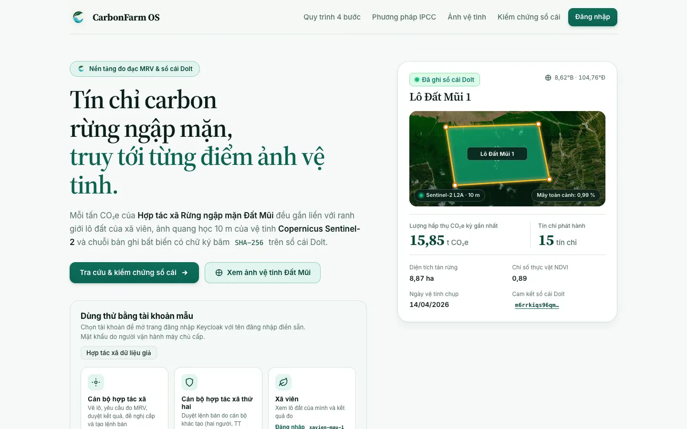
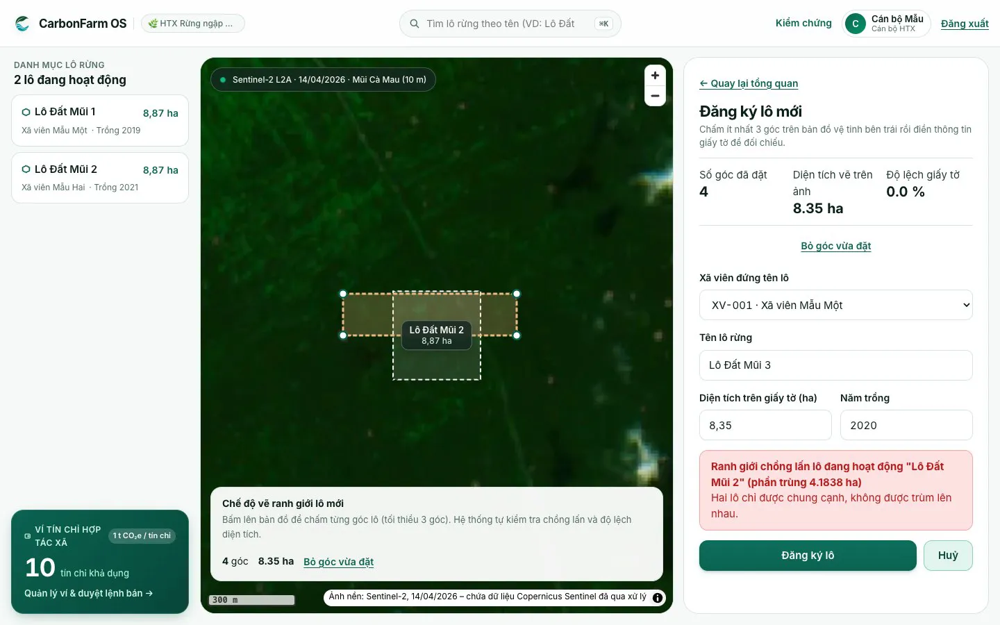
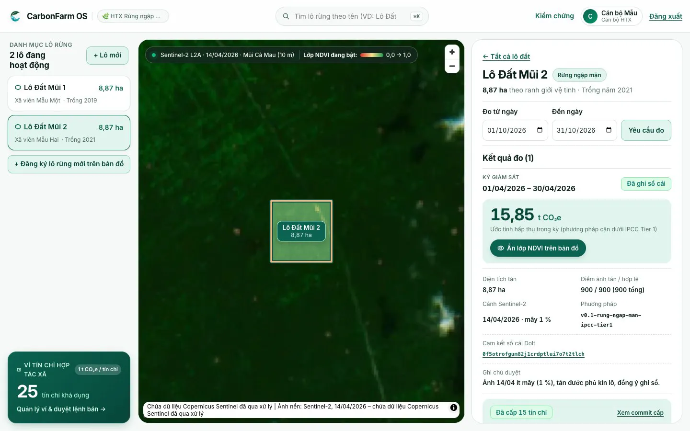
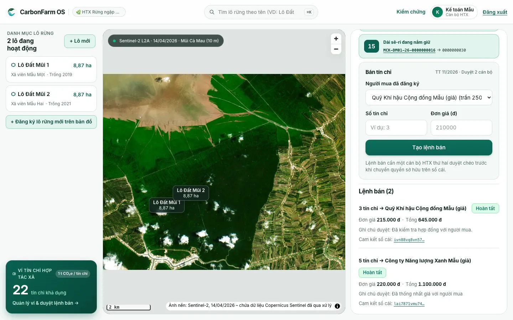
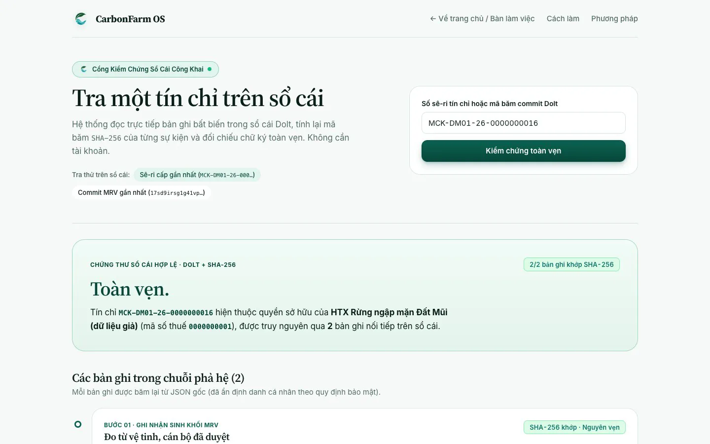
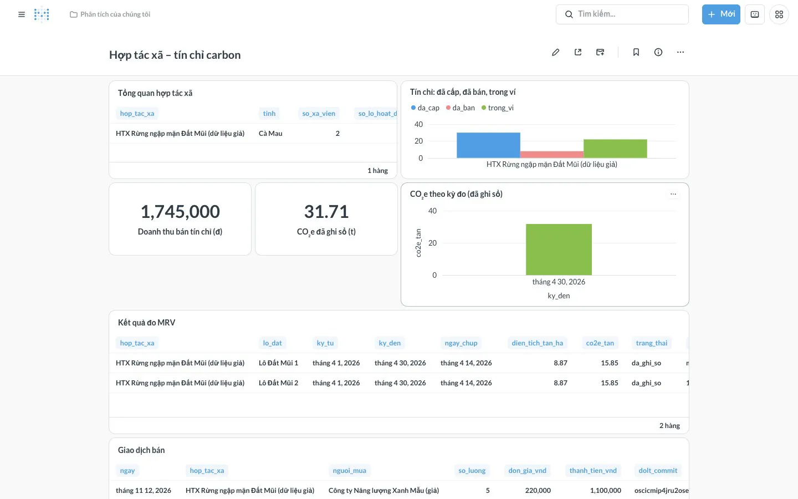

<!-- SPDX-FileCopyrightText: 2026 CarbonFarm OS contributors -->
<!-- SPDX-License-Identifier: GPL-3.0-or-later -->
Tiếng Việt | [English](README.en.md)

<div align="center">


# CarbonFarm OS

**Nền tảng nguồn mở tín chỉ carbon cho nông dân nhỏ, hợp tác xã và cộng đồng ven biển.**<br>
*"Người dân sống được với rừng nhờ carbon."*

<p>
  <a href="LICENSE"></a>
  <a href="https://github.com/carbonfarm-os/carbonfarm-os/actions/workflows/ci.yml"></a>
  <a href="https://github.com/carbonfarm-os/carbonfarm-os/releases/latest"></a>
</p>

<p>
  <a href="https://carbonfarm.dzfullstack.com"><b>Demo</b></a> ·
  <a href="https://carbonfarm-os.github.io/carbonfarm-os/"><b>Tài liệu</b></a> ·
  <a href="#app-di-động"><b>Tải APK</b></a> ·
  <a href="https://carbonfarm.dzfullstack.com/kiem-chung"><b>Kiểm chứng một tín chỉ</b></a>
</p>

Đội **DTU1** · OLP Phần mềm nguồn mở 2026 · Đề tài DX-OS Open-Core

</div>

## Mục lục
1. [Ý tưởng bài toán](#ý-tưởng-bài-toán)
2. [Giải pháp](#giải-pháp)
3. [Giao diện ứng dụng](#giao-diện-ứng-dụng)
4. [Kiến trúc hệ thống](#kiến-trúc-hệ-thống)
5. [Tính năng chính theo đối tượng](#tính-năng-chính-theo-đối-tượng)
6. [Kiểm chứng tín chỉ công khai](#kiểm-chứng-tín-chỉ-công-khai)
7. [Kết nối (connectors)](#kết-nối-connectors)
8. [Cấu trúc dự án](#cấu-trúc-dự-án)
9. [Công nghệ sử dụng](#công-nghệ-sử-dụng)
10. [Cài đặt](#cài-đặt)
11. [Demo](#demo)
12. [Tài liệu](#tài-liệu)
13. [Đóng góp](#đóng-góp)
14. [Giấy phép](#giấy-phép)
15. [Liên hệ](#liên-hệ)
16. [Tác giả](#tác-giả)

## Ý tưởng bài toán
**Tín chỉ carbon** chứng nhận 1 tấn CO₂e được giảm hoặc hấp thụ. Nông dân, chủ rừng, cộng đồng ven biển trồng và giữ rừng (nhất là rừng ngập mặn) là những người tạo ra tín chỉ. Muốn được cấp tín chỉ, họ phải qua **MRV**: đo lường, báo cáo, xác minh.

### Vấn đề cần giải quyết
1. **Nông dân nhỏ thiếu MRV số hóa.** Đo sinh khối bằng tay tốn công, phải thuê chuyên gia và khó lặp lại. Một hộ giữ vài hecta rừng ngập mặn khó tự làm hồ sơ để được cấp tín chỉ.
2. **Công cụ hiện có không dành cho Việt Nam.** Các nền tảng carbon nông nghiệp lớn trên thế giới (Agreena, Nori, Indigo Ag) đều đóng nguồn, nhắm thị trường Mỹ/EU, không có tiếng Việt và không làm rừng ngập mặn.
3. **Con số carbon khó kiểm chứng.** Người mua và cơ quan quản lý cần biết một tín chỉ lấy từ cảnh ảnh nào, theo phương pháp nào, ai duyệt, đã bán cho ai. Một bảng tính gửi qua email thì không cho biết những điều đó.
4. **Dễ sai từ khâu nhập liệu.** Lô đất vẽ chồng lên lô khác, diện tích khai báo lệch bản đồ, một người tự tạo rồi tự duyệt lệnh bán: các lỗi này phải được chặn ngay trong hệ thống, không đợi kiểm tra cuối kỳ.

*Ví dụ trong bản demo (dữ liệu giả):* hợp tác xã rừng ngập mặn ở Đất Mũi (Cà Mau) có hai lô, mỗi lô khoảng 8,87 ha. Cán bộ yêu cầu đo một kỳ. Hệ thống lấy ảnh Sentinel-2, tính ra khoảng 15,85 t CO₂e cho Lô Đất Mũi 2 ([cách tính](methodology/v0.1-rung-ngap-man-ipcc-tier1.md)). Cán bộ duyệt kết quả, Registry mô phỏng cấp 15 tín chỉ vào ví. Ai cũng tra được số sê-ri trên sổ cái.

### Đối tượng người dùng
| Đối tượng | Nhu cầu |
|---|---|
| Cán bộ hợp tác xã | Quản lý lô đất của xã viên, yêu cầu đo và duyệt MRV, cấp và bán tín chỉ, theo dõi doanh thu, kể cả trên điện thoại |
| Xã viên (nông dân nhỏ) | Đăng ký và xem lô đất của mình; biết lô đã được đo chưa, đã cấp bao nhiêu tín chỉ |
| Người mua tín chỉ (doanh nghiệp, quỹ) | Mua tín chỉ có nguồn gốc rõ ràng (trong bản MVP là connector mô phỏng) |
| Người tra cứu công khai (cơ quan quản lý, báo chí, người mua) | Kiểm chứng một tín chỉ trên sổ cái mà không cần tài khoản, gõ sê-ri hoặc quét QR |
| Người phát triển | Thêm miền nghiệp vụ mới hoặc thay connector mô phỏng bằng hệ thống thật mà không sửa lõi |

## Giải pháp
CarbonFarm OS số hóa **hợp tác xã** như một doanh nghiệp: quản lý xã viên, lô đất, hồ sơ MRV, ví tín chỉ và doanh thu. Hệ thống ước lượng carbon từ ảnh vệ tinh mở theo một phương pháp có phiên bản. Cán bộ duyệt từng kết quả. Mỗi con số truy được nguồn: cảnh ảnh, ngày chụp, tỷ lệ mây, phiên bản phương pháp, người duyệt. Mỗi lần cấp và bán tín chỉ được ghi vào sổ cái có phiên bản. Luồng chính:

**đăng ký lô đất → ước lượng carbon từ ảnh Sentinel-2 → duyệt MRV → cấp tín chỉ vào ví → bán cho người mua (mô phỏng) → kiểm chứng trên sổ cái**

Bản MVP gồm một hệ sinh thái (rừng ngập mặn) và một khu vực mẫu; **dữ liệu hợp tác xã là dữ liệu giả**. Đề xuất đầy đủ: [`docs/de-xuat.md`](docs/de-xuat.md).

### Mô hình hai tầng và không gian H-P-D-I
- **Tầng 1 – `platform/` (headless):** dịch vụ lõi tổng quát, không chứa nghiệp vụ carbon. Gồm đăng nhập một lần, API Gateway, quản lý bí mật, dữ liệu có cấu trúc và không gian, dữ liệu phi cấu trúc, workflow, event bus, sổ cái có phiên bản. Chỉ có UI quản trị, không có giao diện người dùng cuối.
- **Tầng 2 – `domains/carbon/`:** miền tín chỉ carbon, gồm cơ sở dữ liệu nghiệp vụ, MRV engine, web, app di động, dashboard. Trong không gian H-P-D-I, đội tập trung vào:
  - **[P] Quy trình:** đăng ký lô → đo → duyệt → cấp → bán, có ràng buộc chống sai ngay trong cơ sở dữ liệu;
  - **[D] Dữ liệu:** bản đồ, phả hệ dữ liệu MRV, sổ cái, dashboard.
  - [I] để sau MVP.
- **`connectors/`:** Registry, người mua, ngân hàng là connector mô phỏng có hợp đồng OpenAPI. Thay bằng hệ thống thật mà không sửa lõi.

### Điểm nổi bật
| Điểm nổi bật | Cụ thể |
|---|---|
| Dữ liệu mở, tái lập được | Ảnh Sentinel-2 từ danh mục STAC công khai, xử lý bằng GDAL/rasterio. Phương pháp ghi trong [`methodology/`](methodology/), có phiên bản và trích dẫn |
| Mỗi con số truy được nguồn | Kết quả MRV lưu cảnh ảnh, ngày chụp, tỷ lệ mây, phiên bản phương pháp, người duyệt |
| Sổ cái có phiên bản | Mỗi lần ghi kết quả MRV, cấp và bán là một commit Dolt có mã băm. SHA-256 từng bản ghi được tính lại khi tra cứu |
| Chống sai ngay trong cơ sở dữ liệu | Từ chối lô chồng lấn (UC005), diện tích lệch bản đồ quá 10 % (UC004), từ chối kết quả mà không có lý do (UC015), người tạo tự duyệt lệnh bán (UC031) |
| Duyệt hai người | Lệnh bán do một cán bộ tạo, cán bộ khác của hợp tác xã duyệt (theo Thông tư 11/2026/TT-BNNMT) |
| Kiểm chứng công khai | Trang `/kiem-chung` và app di động tra sê-ri không cần tài khoản |
| Web và app di động | Web SvelteKit + bản đồ MapLibre; app Flutter (Android + iOS) cho cán bộ và người tra cứu |
| Cắm–rút miền nghiệp vụ | Thêm miền mới không sửa Tầng 1, có miền mẫu thủy sản ([`docs/viet-mien.md`](docs/viet-mien.md)) |
| Nguồn mở trọn vẹn | GPL-3.0-or-later; mọi thành phần bên thứ ba có giấy phép OSI hoặc chạy như dịch vụ riêng bằng image gốc |

## Giao diện ứng dụng
<table>
  <tr>
    <td width="50%"><br>1. Trang chủ công khai: giới thiệu luồng và thẻ tài khoản mẫu</td>
    <td width="50%"><br>2. Đăng ký lô (cán bộ HTX): cơ sở dữ liệu từ chối ranh giới chồng lấn (UC005)</td>
  </tr>
  <tr>
    <td><br>3. Duyệt MRV (cán bộ HTX): ghi sổ cái, cấp 15 tín chỉ, ví lên 25</td>
    <td><br>4. Bán 3 tín chỉ: cán bộ thứ hai duyệt chéo, ví còn 22</td>
  </tr>
  <tr>
    <td><br>5. Kiểm chứng công khai (không cần tài khoản): sổ cái Dolt báo "Toàn vẹn."</td>
    <td><br>6. Dashboard hợp tác xã (Metabase OSS): tín chỉ, doanh thu, kết quả đo</td>
  </tr>
</table>

Ảnh dùng dữ liệu giả; ảnh nền chứa dữ liệu Copernicus Sentinel đã qua xử lý (2026). Chạy lại luồng demo trên máy mình: [`docs/demo/huong-dan-demo.md`](docs/demo/huong-dan-demo.md).

**App di động (Flutter):** có hai thẻ. Thẻ "Hợp tác xã" (đăng nhập) hiện ví tín chỉ và lô đất; thẻ "Kiểm chứng" (không cần đăng nhập) cho gõ sê-ri hoặc quét QR. Mô tả từng màn: [`domains/carbon/di-dong/README.md`](domains/carbon/di-dong/README.md).

## Kiến trúc hệ thống


| Lớp | Thành phần |
|---|---|
| Người dùng | Web (SvelteKit), app di động (Flutter), trang kiểm chứng công khai, dashboard Metabase |
| Gateway | APISIX: kiểm JWT của Keycloak bằng JWKS; riêng `/kiem-chung/api` công khai, giới hạn tần suất |
| Tầng 1 | Keycloak, OpenBao, PostgreSQL + PostGIS + PostGraphile, Versity S3 + STAC + TiTiler, Prefect, Valkey, Dolt |
| Tầng 2 | Lược đồ `carbon` (bảng, RLS, ràng buộc UC0xx), MRV engine Python, dịch vụ kiểm chứng sổ cái |
| Connector | Registry, Buyer, Bank mô phỏng (FastAPI, OpenAPI) |

**Luồng xử lý chính:**
1. Cán bộ vẽ lô trên bản đồ. Web gọi GraphQL `/graphql`, PostgreSQL kiểm hình học, diện tích, chồng lấn và quyền (RLS) rồi mới ghi.
2. Cán bộ yêu cầu đo một kỳ. Prefect chạy flow MRV: tìm cảnh Sentinel-2 qua STAC, tính NDVI, ước lượng CO₂e theo [`methodology/`](methodology/), lưu COG lên S3, rồi chờ cán bộ duyệt.
3. Kết quả được duyệt thì ghi sổ cái Dolt. Cán bộ đề nghị cấp, MRV engine gọi Registry Connector để nhận dải sê-ri, ghi sổ cái, rồi ghi vào ví hợp tác xã.
4. Lệnh bán được cán bộ thứ hai duyệt. Buyer Connector nhận đơn, Registry chuyển quyền sở hữu, Bank Connector ghi có. Giao dịch được ghi sổ cái và trừ khỏi ví.
5. Ai cũng tra được sê-ri hoặc commit qua `/kiem-chung`: hệ thống đọc sổ cái, tính lại SHA-256, hiện chuỗi bản ghi.

Chi tiết: [`docs/architecture.md`](docs/architecture.md). Các quyết định kiến trúc: [`docs/adr/`](docs/adr/).

## Tính năng chính theo đối tượng
**Cán bộ hợp tác xã** (tài khoản mẫu `canbo-htx-mau`, `canbo-htx-mau-2`)
- Vẽ ranh giới lô trên ảnh Sentinel-2. Cơ sở dữ liệu từ chối các trường hợp:
  - hình sai (UC001, UC002);
  - diện tích ngoài 0,05–500 ha (UC003);
  - diện tích khai lệch hình vẽ quá 10 % (UC004);
  - lô chồng lấn lô đang hoạt động (UC005).
- Yêu cầu đo một kỳ. MRV engine tìm cảnh Sentinel-2, tính NDVI và CO₂e, hiện lớp NDVI trên bản đồ.
- Duyệt hoặc từ chối kết quả MRV; từ chối phải có lý do. Kết quả được duyệt ghi vào sổ cái Dolt, có mã commit.
- Đề nghị cấp tín chỉ vào ví hợp tác xã qua Registry Connector (mô phỏng), nhận dải số sê-ri theo Thông tư 11/2026/TT-BNNMT.
- Tạo lệnh bán cho người mua; cán bộ thứ hai duyệt.
- Xem dashboard hợp tác xã: tín chỉ đã cấp, đã bán, còn trong ví, doanh thu, kết quả đo.
- Trên app di động: đăng nhập Keycloak, xem ví tín chỉ (đã cấp, đã bán, trong ví), danh sách lô, chi tiết lô và các kỳ đo.

**Xã viên** (`xavien-mau-1`, `xavien-mau-2`)
- Chỉ thấy và sửa lô của mình (phân quyền theo dòng trong PostgreSQL). Đăng ký lô cho người khác bị từ chối (UC006).

**Người tra cứu công khai** (không cần tài khoản)
- Tra số sê-ri hoặc mã commit trên web `/kiem-chung` hoặc trên app (gõ tay, quét QR). Xem mục [Kiểm chứng tín chỉ công khai](#kiểm-chứng-tín-chỉ-công-khai).

**Quản trị viên**
- UI quản trị của Keycloak, OpenBao, Prefect và Metabase, chỉ mở trên máy chạy hệ thống.

**Người phát triển**
- Thêm miền nghiệp vụ mới mà không sửa Tầng 1: [`docs/viet-mien.md`](docs/viet-mien.md), miền mẫu [`examples/mien-mau-thuy-san/`](examples/mien-mau-thuy-san/).
- Thay connector mô phỏng bằng hệ thống thật theo cùng hợp đồng OpenAPI (mục [Kết nối](#kết-nối-connectors)).

## Kiểm chứng tín chỉ công khai
Trang https://carbonfarm.dzfullstack.com/kiem-chung và thẻ "Kiểm chứng" trên app di động đều gọi cùng API chỉ đọc `/kiem-chung/api`. API này không cần đăng nhập và bị giới hạn 60 yêu cầu/phút cho mỗi địa chỉ IP.
- **Tra theo số sê-ri** (ví dụ dạng `MCK-DM01-26-0000000001`): hiện chủ sở hữu hiện tại theo sổ cái và chuỗi bản ghi nối tiếp: đo từ vệ tinh và cán bộ duyệt → Registry cấp → bán, chuyển quyền sở hữu.
- **Tra theo mã commit Dolt:** hiện các bản ghi trong commit đó.
- Với mỗi bản ghi, hệ thống tính lại SHA-256 từ JSON gốc và so với mã băm lưu trong sổ cái. Kết luận là "Toàn vẹn." hoặc "Có bản ghi không khớp.". Định danh người dùng trong bản ghi đã được ẩn.
- Sê-ri chưa được cấp hoặc sê-ri giả: báo "Không có bản ghi.".
- Mã QR có thể chứa số sê-ri hoặc đường link `.../kiem-chung?q=<sê-ri>`; app đọc được cả hai.

Lý do chọn Dolt làm sổ cái: [ADR 0003](docs/adr/0003-so-cai-co-phien-ban-bang-dolt.md).

## Kết nối (connectors)
Bản MVP chưa có đối tác thật, nên ba hệ thống bên ngoài được mô phỏng trong [`connectors/`](connectors/). Mỗi connector có hợp đồng OpenAPI riêng, dữ liệu giả, không xử lý tiền thật.

| Connector | Mô phỏng | Dùng ở bước |
|---|---|---|
| Registry (`connectors/registry/`) | Hệ thống đăng ký tín chỉ quốc gia, mã trong nước và dải sê-ri theo Thông tư 11/2026/TT-BNNMT | Cấp tín chỉ, chuyển quyền sở hữu khi bán |
| Buyer (`connectors/buyer/`) | Người mua tín chỉ: danh sách người mua, đơn giá tối đa, nhận đơn | Bán tín chỉ |
| Bank (`connectors/bank/`) | Ngân hàng ghi có tiền bán tín chỉ | Sau khi bán |

Muốn nối hệ thống thật thì viết connector mới theo cùng hợp đồng, không sửa Tầng 1 hay cơ sở dữ liệu miền. Chi tiết: [`connectors/README.md`](connectors/README.md), [ADR 0006](docs/adr/0006-connector-mock-va-hop-dong-openapi.md).

## Cấu trúc dự án
```text
carbonfarm-os/
├── platform/              # Tầng 1, không nghiệp vụ: apisix, keycloak, openbao, postgres, postgraphile, prefect, dolt
├── domains/carbon/        # Tầng 2 – miền carbon
│   ├── db/                #   migration, ràng buộc chống sai, dữ liệu giả
│   ├── mrv/               #   MRV engine Python (Sentinel-2 → NDVI → CO₂e), dịch vụ kiểm chứng sổ cái
│   ├── web/               #   web SvelteKit + MapLibre
│   ├── di-dong/           #   app di động Flutter (Android + iOS)
│   ├── dashboard/         #   script dựng dashboard Metabase
│   ├── keycloak/          #   người dùng mẫu và client app di động của miền
│   └── gateway/           #   route APISIX của miền
├── connectors/            # Registry, Buyer, Bank mô phỏng, mỗi cái một openapi.yaml
├── methodology/           # Phương pháp ước lượng carbon có phiên bản, kèm trích dẫn
├── compose.yaml           # Điểm vào Docker Compose, ghép compose/*.yaml bằng include
├── compose/               # platform.yaml, carbon.yaml, connectors.yaml
├── tests/                 # e2e/*.hurl (đầu-cuối), tich-hop/ (Python)
├── examples/              # miền mẫu thủy sản (ví dụ cắm–rút)
├── docs/                  # kiến trúc, đề xuất, ADR, dùng thử, triển khai, kịch bản demo
├── docs-site/             # trang tài liệu Starlight
├── scripts/spdx.py        # kiểm và thêm header SPDX
└── Taskfile.yml           # lệnh go-task
```

## Công nghệ sử dụng
Mọi dịch vụ chạy bằng image gốc, có ghim phiên bản. Phiên bản, nguồn và ngày đọc giấy phép của từng thành phần: [`DEPENDENCIES.md`](DEPENDENCIES.md); ghi công thành phần bên thứ ba: [`NOTICE`](NOTICE).

| Lớp | Thành phần | Vai trò | Giấy phép |
|---|---|---|---|
| Tầng 1 · Định danh | Keycloak 26.8.1 | Đăng nhập một lần (OIDC, PKCE), realm `dxos` | Apache-2.0 |
| Tầng 1 · Gateway | Apache APISIX 3.19.0 | API Gateway, kiểm JWT bằng JWKS | Apache-2.0 |
| Tầng 1 · Bí mật | OpenBao 2.7.2 | Sinh và giữ mật khẩu dịch vụ | MPL-2.0 |
| Tầng 1 · Dữ liệu | PostgreSQL 17 + PostGIS + pgSTAC | Dữ liệu có cấu trúc, không gian, danh mục STAC | PostgreSQL License / GPL-2.0-or-later / MIT |
| Tầng 1 · API | PostGraphile 5.1.5 | API GraphQL tự sinh từ PostgreSQL, quyền bằng RLS | MIT |
| Tầng 1 · Lưu trữ | Versity S3 Gateway 1.10.0, stac-fastapi-pgstac 7.2.0, TiTiler 2.4.0 | Ảnh COG, danh mục STAC, tile bản đồ | Apache-2.0 / MIT / MIT |
| Tầng 1 · Workflow | Prefect 3.9.0 | Flow MRV có bước chờ duyệt | Apache-2.0 |
| Tầng 1 · Sự kiện | Valkey 9.1.3 | Event bus (Streams) | BSD-3-Clause |
| Tầng 1 · Sổ cái | Dolt 2.6.1 | Sổ cái có phiên bản, mỗi lần ghi là một commit có mã băm | Apache-2.0 |
| Tầng 2 · MRV | Python: rasterio + GDAL, numpy, psycopg, PyMySQL, boto3 | Ước lượng carbon, ghi sổ cái | Mã dự án GPL-3.0-or-later; thư viện BSD-3-Clause, LGPL-3.0, MIT, Apache-2.0 |
| Tầng 2 · Web | SvelteKit 3 + Svelte 5 + MapLibre GL JS 6 | Giao diện người dùng cuối, bản đồ | MIT / BSD-3-Clause |
| Tầng 2 · Di động | Flutter 3.50 (Dart), flutter_appauth, flutter_zxing | App Android + iOS, đăng nhập OIDC, quét QR | BSD-3-Clause / BSD-3-Clause / MIT |
| Tầng 2 · Dashboard | Metabase OSS 0.64.3 | Dashboard hợp tác xã (dịch vụ riêng, image gốc, không sửa) | AGPL-3.0 |
| Connector | FastAPI + uvicorn + pydantic | Registry, Buyer, Bank mô phỏng | MIT / BSD-3-Clause / MIT |
| Dữ liệu | Sentinel-2 L2A (STAC Earth Search) | Ảnh vệ tinh mở | Dữ liệu mở Copernicus Sentinel |

**Công cụ phát triển:** go-task, pixi, Hurl, pre-commit, ruff, yamllint, release-please, Syft (SBOM CycloneDX), Starlight (trang tài liệu).

**Đội chủ động không dùng:** immudb (Business Source License), MinIO (repo đã lưu trữ), Google Earth Engine (dịch vụ độc quyền; đội chọn STAC + GDAL để tái lập được), `metabase-enterprise`, `mobile_scanner` (bản Android kéo theo SDK đóng).

## Cài đặt
### Yêu cầu
| Thành phần | Yêu cầu | Ghi chú |
|---|---|---|
| Docker Engine + Docker Compose | Compose v2 hỗ trợ `include:` (từ 2.20) | Chạy toàn bộ dịch vụ |
| go-task | 3.x | Chạy lệnh trong [`Taskfile.yml`](Taskfile.yml) |
| RAM | Đo được khoảng 3,9 GB khi cả stack chạy (v0.5.0, `docker stats`) | Metabase khoảng 1,8 GB, Keycloak khoảng 0,8 GB; thiếu RAM thì tắt Metabase |
| Ổ đĩa | Các image cộng lại khoảng 10,4 GB (máy dev arm64) | Cộng thêm chỗ cho volume dữ liệu |
| Internet | Cần | MRV tải ảnh Sentinel-2 từ Earth Search |
| Python + GDAL (chỉ máy dev) | `pixi install` hoặc Dev Container | Không cần nếu chỉ chạy stack |
| App di động (tùy chọn) | Flutter 3.50; Xcode 27 cho iOS; Android SDK + JDK 21 cho Android | Xem [README app](domains/carbon/di-dong/README.md) |

**Hệ điều hành đã chạy thật:** macOS trên Apple Silicon (máy dev) và Ubuntu (máy chủ demo). Windows chưa thử.

### Chạy trên một máy
```bash
cp .env.example .env      # cấu hình máy dev
task up                   # chạy toàn bộ dịch vụ (Docker Compose)
task smoke                # kiểm thử đầu-cuối bằng Hurl
```

Sau khi chạy:

| Địa chỉ | Nội dung |
|---|---|
| http://localhost:9080/ | Web: trang chủ, đăng nhập cán bộ, bản đồ lô đất, MRV, ví và lệnh bán |
| http://localhost:9080/kiem-chung | Tra tín chỉ trên sổ cái, không cần tài khoản |
| http://127.0.0.1:3001/ | Dashboard hợp tác xã (Metabase OSS) |

- **Mật khẩu người dùng mẫu** (`canbo-htx-mau`, `canbo-htx-mau-2`, `xavien-mau-1`…) do OpenBao sinh khi dựng. Lấy bằng `docker compose exec keycloak cat /run/bimat/mk-<tên>`, ví dụ `mk-canbo-htx-mau`.
- **Khóa mở OpenBao:** lần chạy đầu, OpenBao ghi khóa vào `.data/openbao/` (ngoài git). **Giữ kín tệp này; mất là không mở được dữ liệu OpenBao.**
- **Dùng thử theo kịch bản:** [`docs/thu-nghiem.md`](docs/thu-nghiem.md).
- **Lệnh khác:**
  - `task check`: SPDX + compose, chạy trước mọi PR;
  - `task test`: kiểm thử không cần stack chạy;
  - `task lint`;
  - `task license`: thêm header SPDX;
  - `task tai-lieu`: build trang tài liệu.

### App di động
- **Tải APK:** job `di-dong` của CI build APK ở mỗi PR và tải lên mục Artifacts (`carbonfarm-apk`). Từ bản phát hành kế tiếp sau v0.7.0, APK (`carbonfarm-X.Y.Z.apk`) được đính vào [GitHub Release](https://github.com/carbonfarm-os/carbonfarm-os/releases), mã băm ghi trong `SHA256SUMS`. APK hiện ký bằng khóa debug: cài thử được, chưa lên Google Play.
- **Tự build:**

  ```bash
  cd domains/carbon/di-dong
  flutter pub get
  flutter run --dart-define=API_URL=http://localhost:9080   # nối stack cục bộ; bỏ --dart-define để dùng bản demo
  flutter build apk --release                               # hoặc: flutter build ios --release --no-codesign
  ```

### Dừng và xóa dữ liệu
```bash
task down                 # dừng dịch vụ, giữ volume dữ liệu
docker compose down -v    # dừng và xóa toàn bộ volume (mất dữ liệu đã nhập)
```

Triển khai trên máy chủ có HTTPS: [`docs/trien-khai.md`](docs/trien-khai.md).

## Demo
- **Web:** https://carbonfarm.dzfullstack.com, dữ liệu giả.
- **Kiểm chứng công khai:** https://carbonfarm.dzfullstack.com/kiem-chung, không cần tài khoản.
- **Tài khoản thử và các nhiệm vụ gợi ý:** [`docs/thu-nghiem.md`](docs/thu-nghiem.md).
- **Góp ý sau khi dùng thử:** mẫu issue "Phản hồi dùng thử" trên [GitHub Issues](https://github.com/carbonfarm-os/carbonfarm-os/issues/new/choose).
- **App di động** mặc định nối tới bản demo này.

## Tài liệu
Trang tài liệu (có tìm kiếm): https://carbonfarm-os.github.io/carbonfarm-os/

| Tài liệu | Nội dung |
|---|---|
| [`CHANGELOG.md`](CHANGELOG.md) | Thay đổi theo phiên bản (release-please sinh tự động) |
| [`CONTRIBUTING.md`](CONTRIBUTING.md) | Quy trình đóng góp, môi trường dev |
| [`CODE_OF_CONDUCT.md`](CODE_OF_CONDUCT.md) | Quy tắc ứng xử |
| [`docs/de-xuat.md`](docs/de-xuat.md) | Đề xuất: bài toán, phạm vi MVP |
| [`docs/architecture.md`](docs/architecture.md) | Kiến trúc hai tầng, sơ đồ |
| [`docs/adr/`](docs/adr/) | Các quyết định kiến trúc (ADR 0001–0009) |
| [`methodology/`](methodology/) | Phương pháp ước lượng carbon có phiên bản |
| [`connectors/README.md`](connectors/README.md) | Connector mô phỏng và hợp đồng OpenAPI (API) |
| [`platform/README.md`](platform/README.md) | Tầng 1: các dịch vụ nền tảng |
| [`domains/carbon/README.md`](domains/carbon/README.md) | Tầng 2: miền carbon |
| [`domains/carbon/di-dong/README.md`](domains/carbon/di-dong/README.md) | App di động: chạy, kiểm thử, build |
| [`docs/thu-nghiem.md`](docs/thu-nghiem.md) | Hướng dẫn dùng thử theo sáu nhiệm vụ |
| [`docs/trien-khai.md`](docs/trien-khai.md) | Triển khai demo công khai |
| [`docs/viet-mien.md`](docs/viet-mien.md) | Viết một miền nghiệp vụ mới (cắm–rút) |
| [`docs/demo/huong-dan-demo.md`](docs/demo/huong-dan-demo.md) | Hướng dẫn chạy lại demo: chuẩn bị dữ liệu, luồng từng bước, kết quả mong đợi |
| [`docs/roadmap.md`](docs/roadmap.md) | Lộ trình |

## Đóng góp
1. **Mở issue** bằng mẫu có sẵn ("Báo lỗi", "Phản hồi dùng thử", "Việc cần làm").
2. **Tạo nhánh ngắn** từ `main`, đặt tên `<loại>/<số-issue>-<tên>`.
3. **Commit** theo Conventional Commits, mô tả tiếng Việt, kèm `(#số-issue)`.
4. **Mở PR** về `main`. CI phải xanh; chủ vùng mã khác người viết duyệt (theo [`CODEOWNERS`](.github/CODEOWNERS)); merge kiểu squash.
5. **Phát hành:** release-please tự sinh CHANGELOG, tag `vX.Y.Z` và GitHub Release kèm `.tar.gz`, `SHA256SUMS`, SBOM.

Chi tiết: [`CONTRIBUTING.md`](CONTRIBUTING.md).
- Việc cho người mới: nhãn [`good first issue`](https://github.com/carbonfarm-os/carbonfarm-os/labels/good%20first%20issue).
- Hỏi đáp: [Discussions](https://github.com/carbonfarm-os/carbonfarm-os/discussions).

## Giấy phép
Mã nguồn phát hành theo **GNU General Public License v3.0 hoặc mới hơn** (GPL-3.0-or-later), toàn văn trong [`LICENSE`](LICENSE).

> This program is free software: you can redistribute it and/or modify it under the terms of the GNU General Public License as published by the Free Software Foundation, either version 3 of the License, or (at your option) any later version.

- **Vì sao chọn GPL:** copyleft buộc mọi bản sửa đổi của nền tảng MRV khi phân phối phải công khai mã nguồn. Nhờ vậy con số carbon tính ra luôn kiểm chứng được, và cộng đồng nhận lại phần cải tiến.
- **SPDX trong từng tệp:** mỗi tệp mã có hai dòng `SPDX-FileCopyrightText: 2026 CarbonFarm OS contributors` và `SPDX-License-Identifier: GPL-3.0-or-later`. Kiểm bằng `task check`, thêm bằng `task license`. Tệp không chú thích được (JSON, ảnh, tệp do Flutter/Xcode sinh) được khai ở [`NOTICE`](NOTICE).
- **Thành phần bên thứ ba:** ưu tiên giấy phép OSI tương thích GPL-3.0. Thành phần copyleft khác hoặc không OSI (ví dụ Metabase OSS, AGPL-3.0) chỉ chạy như dịch vụ riêng bằng image gốc, không nhúng, không sửa mã. Danh sách đầy đủ: [`DEPENDENCIES.md`](DEPENDENCIES.md).

## Liên hệ
| Kênh | Dùng cho |
|---|---|
| [GitHub Issues](https://github.com/carbonfarm-os/carbonfarm-os/issues) | Báo lỗi, đề xuất tính năng, phản hồi dùng thử |
| [GitHub Discussions](https://github.com/carbonfarm-os/carbonfarm-os/discussions) | Hỏi đáp, trao đổi |
| [Kho mã](https://github.com/carbonfarm-os/carbonfarm-os) | Mã nguồn, Release, CI |
| [Demo](https://carbonfarm.dzfullstack.com) | Dùng thử với dữ liệu giả |

## Tác giả
Đội **DTU1** · OLP Phần mềm nguồn mở 2026.

| Thành viên (GitHub) | Vai | Phụ trách (theo [`CODEOWNERS`](.github/CODEOWNERS)) |
|---|---|---|
| [`Minhthuan12`](https://github.com/Minhthuan12) | Trưởng nhóm, V1 | Nền tảng Tầng 1 (`platform/`, `compose/`), DevOps, CI, bảo mật |
| [`Nhvuu918`](https://github.com/Nhvuu918) | V2 | Dữ liệu, ảnh vệ tinh, MRV, sổ cái, app di động (`domains/carbon/`, `methodology/`, `connectors/`) |
| [`tamdoannguyen06-cmyk`](https://github.com/tamdoannguyen06-cmyk) | V3 | Web, bản đồ, dashboard (`domains/carbon/web/`, `domains/carbon/dashboard/`) |
