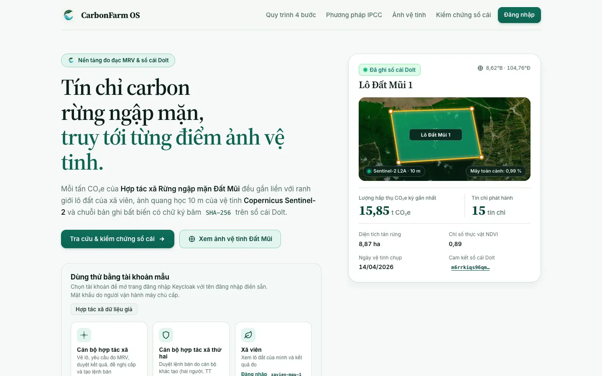
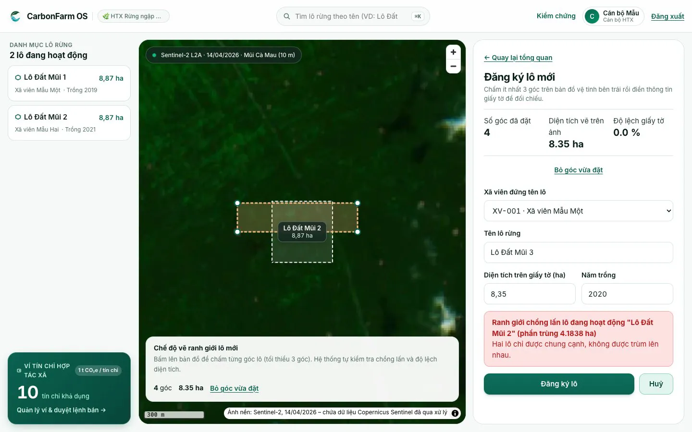
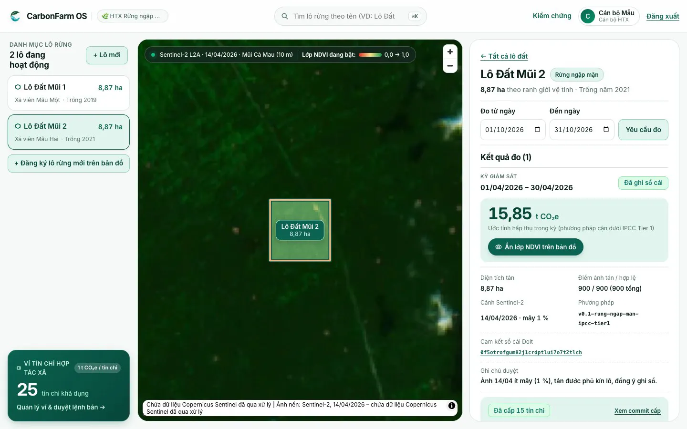
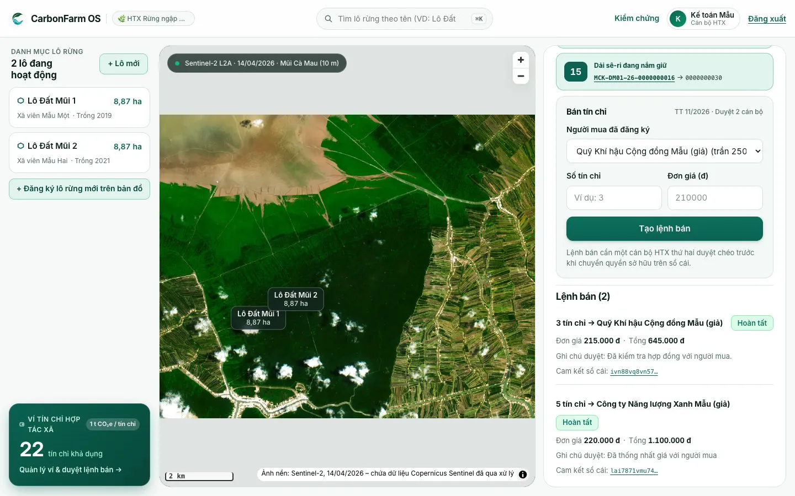
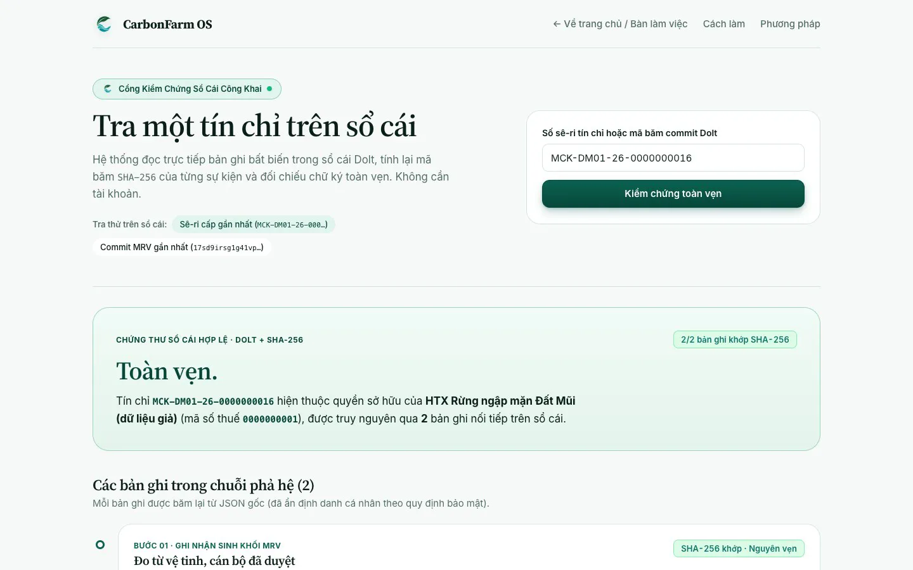
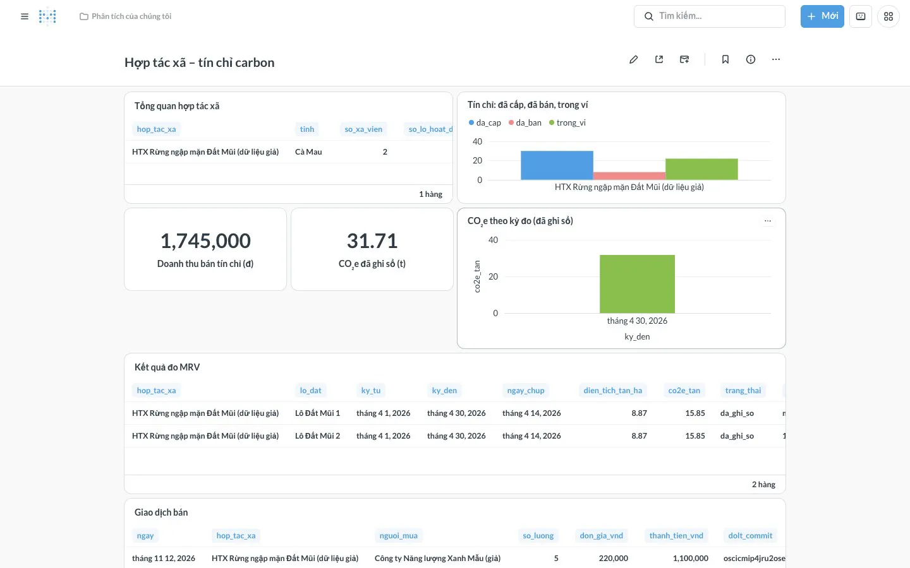

<!-- SPDX-FileCopyrightText: 2026 CarbonFarm OS contributors -->
<!-- SPDX-License-Identifier: GPL-3.0-or-later -->
# Hướng dẫn chạy demo

Tài liệu này dành cho người muốn chạy lại trọn luồng của CarbonFarm OS trên máy mình: vẽ lô → đo carbon → duyệt → cấp tín chỉ → bán → kiểm chứng công khai → dashboard, rồi xem lại trên app di động. Toàn bộ dữ liệu là **dữ liệu giả**. Muốn thử từng nhiệm vụ nhỏ thì xem [`docs/thu-nghiem.md`](../thu-nghiem.md).

## 1. Chuẩn bị dữ liệu demo
Dựng trên volume trống để mọi con số khớp với ảnh trong tài liệu này.

```bash
cp .env.example .env    # .env.example bật NAP_DU_LIEU_MAU=true: nạp hợp tác xã, xã viên, lô đất giả
task up                 # chạy toàn bộ dịch vụ
task smoke              # kiểm thử đầu-cuối; đồng thời tạo một lô đã đo, đã cấp 15 tín chỉ và đã bán 5
```

Sau `task smoke`, ví của hợp tác xã mẫu còn **10 tín chỉ** (cấp 15, bán 5). Sổ cái đã có chuỗi bản ghi đo → cấp → bán, nên tra được ngay ở `/kiem-chung`.

Tiếp theo, tạo một **lô đã đo, đang chờ duyệt**. Việc đo cần Internet để tải ảnh Sentinel-2 và mất khoảng 1–2 phút, nên làm trước khi bắt đầu demo:
1. Mở http://localhost:9080/, bấm **Đăng nhập**, đăng nhập `canbo-htx-mau`.
2. Chọn "Lô Đất Mũi 2", bấm **Yêu cầu đo** (kỳ mặc định là tháng trọn vẹn gần nhất).
3. Đợi đến khi kết quả chuyển sang trạng thái **Chờ cán bộ duyệt**. Không bấm duyệt; bước này để dành cho luồng demo.

### Tài khoản mẫu
| Tài khoản | Vai | Dùng ở bước |
|---|---|---|
| `canbo-htx-mau` | Cán bộ hợp tác xã | Vẽ lô, duyệt MRV, cấp tín chỉ, tạo lệnh bán, app di động |
| `canbo-htx-mau-2` | Cán bộ hợp tác xã thứ hai | Duyệt lệnh bán do người kia tạo |
| `xavien-mau-1` | Xã viên | Xem lô của mình (tùy chọn) |

Mật khẩu do OpenBao sinh lúc dựng, mỗi máy một khác. Lấy bằng lệnh:

```bash
docker compose exec keycloak cat /run/bimat/mk-<tên>    # ví dụ mk-canbo-htx-mau
```

Không ghi mật khẩu vào tài liệu, issue hay tin nhắn.

Để duyệt lệnh bán mà không phải đăng xuất, mở hai cửa sổ trình duyệt riêng (ví dụ một cửa sổ ẩn danh), mỗi cửa sổ đăng nhập một cán bộ.

## 2. Luồng demo
Các số trong cột "Kết quả mong đợi" đúng khi dữ liệu dựng theo mục 1. Nếu đã thao tác thêm thì số trong ví sẽ khác.

| # | Thao tác | Kết quả mong đợi |
|---|---|---|
| 1 | Mở trang chủ http://localhost:9080/ (chưa đăng nhập) | Trang giới thiệu luồng, thẻ tài khoản mẫu, ô tra tín chỉ |
| 2 | Đăng nhập `canbo-htx-mau`, chọn **Đăng ký lô mới**, vẽ một lô đè lên "Lô Đất Mũi 1" rồi gửi | Bị từ chối với thông báo tiếng Việt về ranh giới chồng lấn (mã UC005); không có lô nào được tạo |
| 3 | Vẽ lại lô ở vùng trống, diện tích khai báo khớp hình vẽ, gửi | Lô mới xuất hiện trên bản đồ và trong danh sách lô. Nếu diện tích khai lệch hình vẽ quá 10 % thì bị từ chối (mã UC004) |
| 4 | Mở "Lô Đất Mũi 2", xem kết quả đang chờ duyệt, bật lớp NDVI | Thấy CO₂e của kỳ, diện tích tán, cảnh ảnh, ngày chụp, tỷ lệ mây, phiên bản phương pháp |
| 5 | Bấm **Duyệt và ghi sổ cái Dolt** | Kết quả chuyển sang "Đã ghi sổ cái", có mã commit Dolt |
| 6 | Bấm **Đề nghị cấp … tín chỉ** | Registry mô phỏng cấp dải sê-ri; ví từ 10 lên **25** tín chỉ |
| 7 | Ở ví tín chỉ, tạo lệnh bán 3 tín chỉ cho một người mua | Lệnh ở trạng thái "Chờ cán bộ khác duyệt"; người tạo không thấy nút duyệt |
| 8 | Ở cửa sổ của `canbo-htx-mau-2`, duyệt lệnh bán | Buyer, Registry, Bank mô phỏng xử lý lần lượt, lệnh chuyển sang "Hoàn tất"; ví còn **22** |
| 9 | Mở http://localhost:9080/kiem-chung (không cần đăng nhập), nhập một sê-ri vừa bán | Kết luận "Toàn vẹn.", chuỗi bản ghi đo → cấp → bán, SHA-256 lưu và tính lại khớp nhau, chủ sở hữu là người mua |
| 10 | Nhập một sê-ri không tồn tại, ví dụ `MCK-GIA0-26-0000000099` | "Không có bản ghi." |
| 11 | Mở dashboard http://127.0.0.1:3001/ | Số tín chỉ đã cấp, đã bán, còn trong ví, doanh thu, kết quả đo |

### App di động
Chạy app theo [`domains/carbon/di-dong/README.md`](../../domains/carbon/di-dong/README.md), trỏ tới stack cục bộ: `flutter run --dart-define=API_URL=http://localhost:9080`. Với máy ảo Android, chạy thêm `adb reverse tcp:9080 tcp:9080`.

| # | Thao tác | Kết quả mong đợi |
|---|---|---|
| 12 | Thẻ **Kiểm chứng** (không cần đăng nhập): gõ sê-ri ở bước 9, hoặc quét mã QR chứa sê-ri hay link `.../kiem-chung?q=<sê-ri>` | Cùng kết luận "Toàn vẹn." và chuỗi bản ghi như trên web |
| 13 | Thẻ **Hợp tác xã**: bấm **Đăng nhập**, đăng nhập `canbo-htx-mau` trên trang Keycloak tiếng Việt | Ví tín chỉ hiện đã cấp, đã bán, trong ví khớp với web; có danh sách lô đất |
| 14 | Chạm một lô, rồi chạm một dải sê-ri trong ví | Chi tiết lô và các kỳ đo; chạm sê-ri thì mở màn kiểm chứng của sê-ri đó |

Simulator iOS và máy ảo không có máy ảnh thật nên không quét QR được; dùng ô gõ sê-ri.

## 3. Ảnh tham khảo
Ảnh chụp từ một lần chạy luồng trên với dữ liệu giả. Ảnh nền chứa dữ liệu Copernicus Sentinel đã qua xử lý (2026).

| Bước | Ảnh |
|---|---|
| 1 |  |
| 2 |  |
| 5–6 |  |
| 7–8 |  |
| 9 |  |
| 11 |  |

## 4. Dọn dẹp
```bash
task down                 # dừng dịch vụ, giữ dữ liệu để chạy lại
docker compose down -v    # xóa toàn bộ volume, lần sau dựng lại từ đầu theo mục 1
```

Muốn chạy lại demo với đúng các số trong bảng, xóa volume rồi làm lại mục 1.
